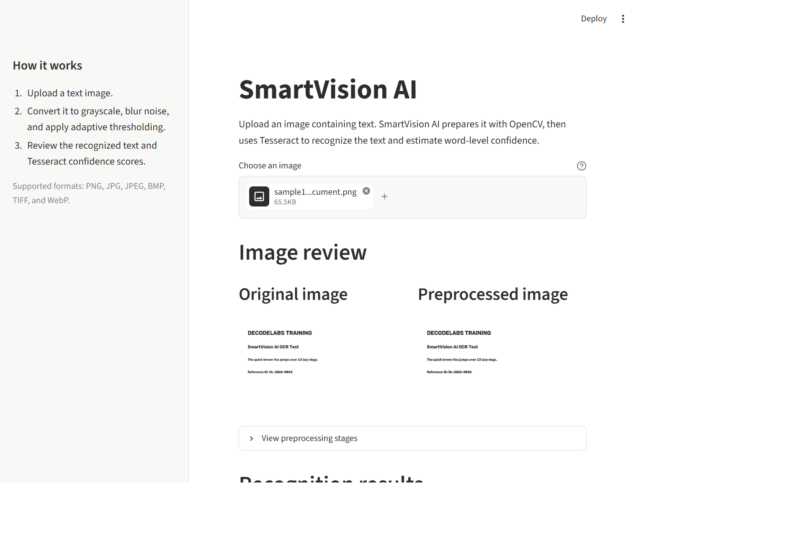
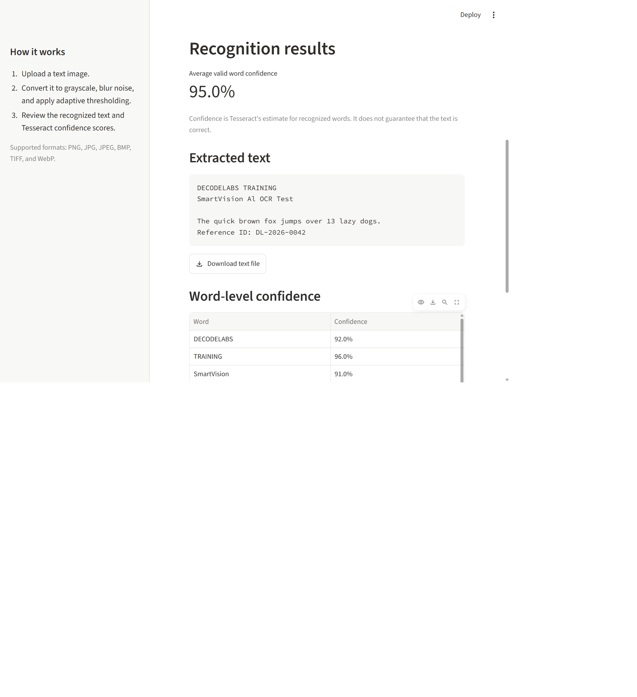

# SmartVision AI — Intelligent Text Recognition System

SmartVision AI is a beginner-friendly OCR application built for DecodeLabs Artificial Intelligence Project 4 (Batch 2026). It accepts an image of printed text, prepares the image with OpenCV, and uses Tesseract OCR to extract the text and report Tesseract's word-level confidence estimates.

## Features

- Upload PNG, JPG/JPEG, BMP, TIFF, or WebP images.
- Preview the original image and the adaptive-threshold result.
- View the grayscale and Gaussian-blurred preprocessing stages.
- Extract text with Tesseract and show each recognized word's confidence.
- Calculate the average of valid word confidence values only.
- Download recognized text as a UTF-8 TXT file.
- Show friendly messages for invalid images, missing Tesseract, and images with no recognized text.

## Technologies

- Python 3.11
- Streamlit
- OpenCV (`opencv-python`)
- Tesseract OCR and `pytesseract`
- NumPy and pandas

## Project structure

```text
.
├── app.py
├── image_processor.py
├── ocr_engine.py
├── requirements.txt
├── README.md
├── samples/
│   ├── sample1_printed_document.png
│   ├── sample2_receipt.png
│   └── sample3_simulated_uneven_lighting.png
└── outputs/
    ├── screenshots/
    ├── technical_project_report.md
    └── test_results.md
```

The uneven-lighting sample is generated for repeatable testing; it is not a camera photograph.

## Installation

1. Install the [Tesseract OCR engine for Windows](https://github.com/UB-Mannheim/tesseract/wiki). The tested installation is at `E:\Program Files\tesseract.exe`. Keep the English language data (`eng`) installed.
2. Open PowerShell in this project directory and activate the existing environment, or create one if setting up on a different computer:

   ```powershell
   .\venv\Scripts\Activate.ps1
   ```

3. Install the Python requirements if they are not already installed:

   ```powershell
   python -m pip install -r requirements.txt
   ```

4. If Tesseract is installed at a different location and is not on PATH, set its executable path for the current PowerShell session:

   ```powershell
   $env:SMARTVISION_TESSERACT_CMD = "C:\Program Files\Tesseract-OCR\tesseract.exe"
   ```

The application also checks the tested path `E:\Program Files\tesseract.exe` and then searches PATH. It reports an actionable error if no executable can be found.

## Run the application

From the project directory, run:

```powershell
streamlit run app.py
```

Open the local address printed by Streamlit, upload an image, and review the recognized text, confidence scores, and processed image. Use **Download text file** to save the OCR output.

## Preprocessing and confidence

The image pipeline converts the input to grayscale, applies a 5-by-5 Gaussian Blur, then uses Gaussian adaptive thresholding (block size 11, constant 2). Tesseract OCR uses English with `--oem 3 --psm 6` by default.

Confidence is Tesseract's estimate for recognized words, on a 0 to 100 scale. Blank words and non-word entries (`-1`) are omitted from the mean. Confidence does not establish that a word is correct. See [test results](outputs/test_results.md) for a separate comparison against sample ground truth.

## Screenshots

The screenshots below show the app with the generated printed-document sample. The second view shows the OCR result and confidence table.





## Test results

See [outputs/test_results.md](outputs/test_results.md) for the sample-image results, confidence and character-error measurements, invalid-input checks, and testing limitations.

See [outputs/submission_checklist.md](outputs/submission_checklist.md) for the project review and GitHub preparation steps.

## Limitations

- OCR quality depends on image resolution, focus, contrast, orientation, font, and page layout.
- The current preprocessing settings are fixed; some images may work better with different threshold settings.
- Tesseract confidence is not a substitute for checking the recognized text against ground truth.
- The included test images are generated examples, not independent real-world photos or scanned documents.
- English OCR is configured by default; other languages require the corresponding Tesseract language data.

## Future improvements

- Evaluate with real photographs and scanned documents under varied lighting.
- Add optional rotation correction and deskewing.
- Let users compare grayscale and thresholding methods for difficult images.
- Add a ground-truth input field and repeatable accuracy evaluation.
- Add automated regression tests and a continuous-integration workflow.
